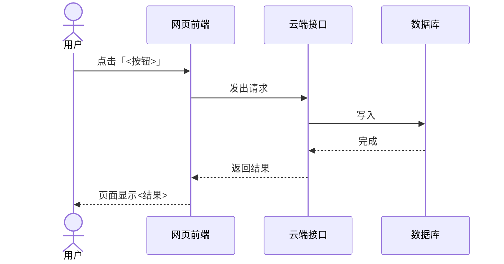

# 功能追踪：<功能名>

基线：`<short-sha>`（<YYYY-MM-DD>）

## 一句话说清

<用户做了什么 → 最后看到什么，中间主要经过哪几块。两三句。>

## 流程图

## 一步一步

| # | 发生了什么（白话） | 代码位置 | 敏感 |
|---|---|---|---|
| 1 | 用户点击「<按钮>」 | `<path:line>` | |
| 2 | <…> | `<path:line>` | ⚠️ <类别> |

## 其他走向

- **没登录时**：<…>。`<path:line>`
- **填写不对时**：<…>。`<path:line>`
- **网络或服务出错时**：<…>。`<path:line>`

## 这个功能碰到的敏感区域

- ⚠️ <类别>：<哪一步、为什么敏感>，见 [敏感区域](../sensitive-areas.md)。

## 未找到 / 未核实

- <…>

## 需要确认的疑点

- <…>
