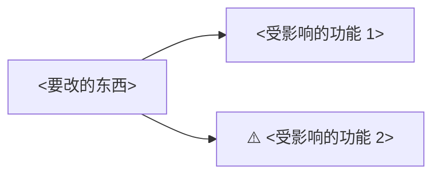

# 改动影响：<想改的东西>

基线：`<short-sha>`（<YYYY-MM-DD>）

## 结论

改动难度：**<低 / 中 / 高>**。理由：<两三条，每条带证据>。

## 你要改的东西在哪里

- <白话说明>：`<path:line>`

## 会牵连到哪里

| 受影响的地方 | 关系 | 用户能感觉到的变化 | 代码位置 |
|---|---|---|---|
| <功能/页面> | 同一功能 / 其他功能 / 多处共用 / 长期存储的数据 / 对外约定 | <…> | `<path:line>` |

## 有没有测试保护

- <有哪些测试覆盖它；没有则写“未找到相关测试”和搜索范围>。`<path>`

## 改完以后建议检查

1. <打开哪个页面、做什么操作、应该看到什么>

## 未找到 / 未核实

- <…>
